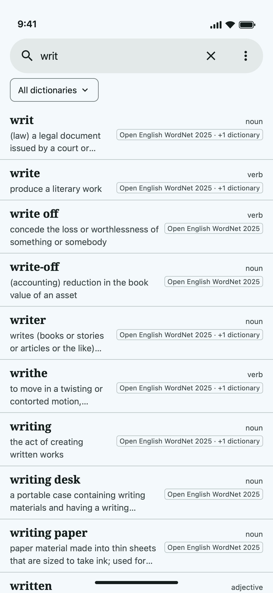
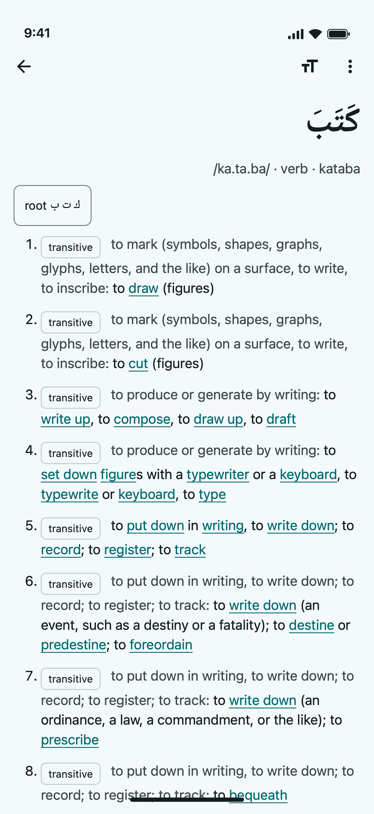
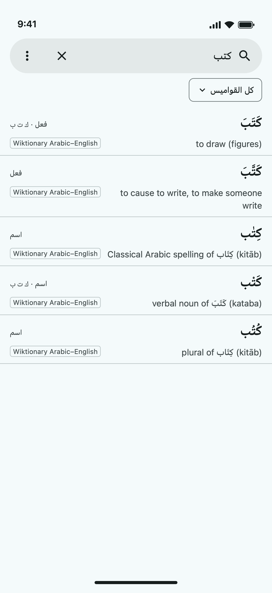
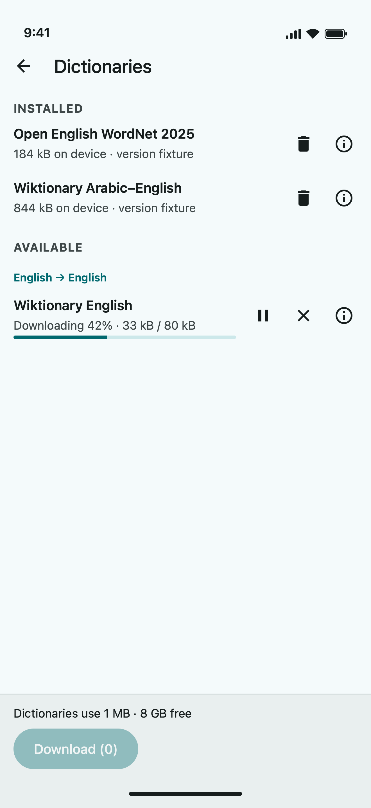

# Lexnur

Free offline dictionaries for Android and iOS: pick monolingual or translation dictionaries, download them once, and look words up without a connection. English and Arabic first.

<a href="https://play.google.com/store/apps/details?id=com.lexnur">Get it on Google Play</a> · App Store version coming soon · https://lexnur.com

<table>
  <tr>
    <td></td>
    <td></td>
    <td></td>
    <td></td>
  </tr>
</table>

Dictionary data comes from open sources (Open English WordNet, Wiktionary via Kaikki, and others), each under its own licence (CC BY / CC BY-SA); see [docs/SOURCES.md](docs/SOURCES.md) for sources, licences and attribution.

## Development

Start with [AGENTS.md](AGENTS.md) (layout, setup, worktree rules), then:

- [docs/RELEASING.md](docs/RELEASING.md) — shipping an app update to the stores.
- [pipeline/README.md](pipeline/README.md) — building and publishing dictionary packages.
- [docs/CATALOG.md](docs/CATALOG.md), [docs/SOURCES.md](docs/SOURCES.md), [docs/HOSTING.md](docs/HOSTING.md) — formats, data sources, hosting.

Setup: `mise install && pnpm install && bundle install`; `just --list` shows the commands.
